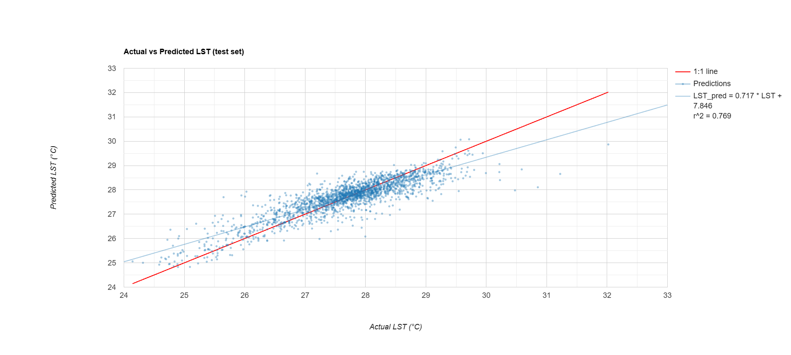
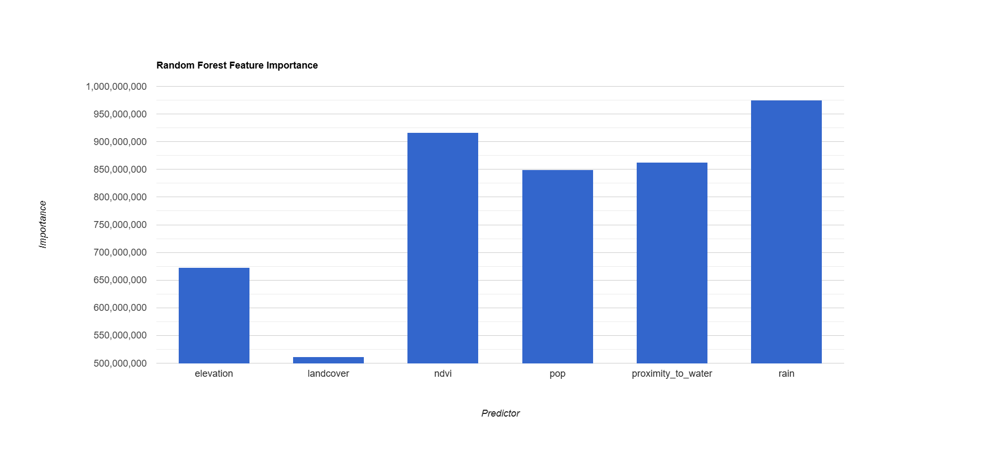

# Predicting Land Surface Temperature in Bangladesh with Random Forest

A Random Forest regression model, built in Google Earth Engine, that predicts long-term mean daytime land surface temperature (LST) across Bangladesh from climate, terrain, vegetation, land cover, population, and water-proximity data. On unseen test points, the model explains **77% of the spatial variation in LST**, with a typical error of **0.45 °C**.

## Objective
To test how well a set of freely available environmental and human predictors can explain the spatial pattern of land surface temperature across Bangladesh, and which predictors matter most.

## Data
| Variable | Dataset | Source | Notes |
|---|---|---|---|
| **LST (target)** | OpenLandMap monthly daytime LST (MOD11A2) | OpenLandMap / MODIS | Long-term mean, 2000–2017, ~1 km |
| Precipitation | OpenLandMap SM2RAIN monthly precipitation | OpenLandMap | Annual total (sum of 12 months), ~1 km |
| Elevation | NASADEM | NASA | 30 m |
| Population | WorldPop Global Project, 100 m | WorldPop | Most recent year available |
| NDVI | MOD13A2 | MODIS | Mean, 2001–2017 |
| Land cover | MCD12Q1, IGBP classification (LC_Type1) | MODIS | Most common class, 2001–2017 |
| Distance to water | Global Surface Water (occurrence ≥ 90%) | JRC | Distance to permanent water, m |
| Boundary | GAUL 2015, Level 0 | FAO | National boundary |

## Method
All processing was done in Google Earth Engine (`gee/bd_lst_random_forest.js`):

1. **Preparation:** All layers were clipped to Bangladesh. The 12 monthly LST layers were averaged and converted to °C, the monthly precipitation layers were summed to annual totals, and NDVI and land cover were summarized over the same period as the LST record.
2. **Distance to water:** Permanent water was defined as pixels that are water at least 90% of the time, and the distance from every pixel to the nearest permanent water was calculated in metres. At the 1 km analysis resolution, this mainly captures large rivers and water bodies.
3. **Sampling:** 10,000 random pixels were sampled at 1 km (the resolution of the LST data) from populated areas, then randomly split into training (~80%) and testing (~20%) sets with a fixed seed. The test set contains 1,994 points.
4. **Model:** A Random Forest regression model with 100 trees was trained to predict LST from six predictors: precipitation, elevation, population, NDVI, land cover, and distance to water.
5. **Evaluation:** Predictions on the test set were compared with observed LST using R², RMSE, and MAE, and plotted against the 1:1 line. Feature importance was taken from the trained model.
6. **Mapping:** The trained model was applied to all of Bangladesh to produce a predicted LST map.

## Results

### Accuracy on the test set

| Metric | Value |
|---|---|
| R² (coefficient of determination) | **0.77** |
| RMSE | **0.45 °C** |
| MAE | **0.33 °C** |
| Mean bias | **0.00 °C** |
| Predictions within ±0.5 °C | **80%** |
| Predictions within ±1.0 °C | **96%** |
| Test points | 1,994 |

- Observed LST in the test set ranged from about 24 to 32 °C (mean 27.7 °C). The model predicted it with an average error of about one-third of a degree and no overall bias.
- **Errors depend on temperature.** The fitted line of predicted against observed LST has a slope of 0.72, below the 1:1 line. The model overestimates the coolest areas and underestimates the hottest ones:

  | Observed LST | Test points | Mean error (predicted − observed) |
  |---|---|---|
  | ≤ 26 °C | 117 | +0.41 °C |
  | 26–27 °C | 259 | +0.32 °C |
  | 27–28 °C | 890 | +0.08 °C |
  | 28–29 °C | 612 | −0.21 °C |
  | > 29 °C | 116 | −0.69 °C |

  This is a known behaviour of Random Forest regression, which averages predictions towards the mean and cannot predict beyond the range it has seen often in training. It means the model is least reliable for the hottest places, which are often the most important for heat risk.

### Feature importance

| Predictor | Share of total importance |
|---|---|
| Annual precipitation | 20.4% |
| NDVI | 19.1% |
| Distance to permanent water | 18.0% |
| Population | 17.7% |
| Elevation | 14.1% |
| Land cover (IGBP) | 10.7% |

- **Precipitation and NDVI** were the most important predictors, followed closely by distance to water and population. Importance is spread fairly evenly across the predictors, suggesting that LST in Bangladesh reflects a combination of climate, vegetation, hydrology, and human settlement rather than any single factor.
- **Land cover** contributed least, partly because most sampled pixels fall into just a few classes (croplands and cropland/natural vegetation mosaic make up two-thirds of the test set), and partly because NDVI already captures much of the same information.
- In the test data, LST was higher where population was denser (r = 0.23) and lower where rainfall was higher (r = −0.25).

## How to Reproduce
1. Open the script in the Earth Engine Code Editor: [Open in GEE](https://code.earthengine.google.com/22bba6b1ce24e78cf70f3f2f4a30d555)
2. Run it. All data comes from the public Earth Engine catalog, so no uploads are needed, and a fixed random seed makes the results repeatable.
3. The Console shows the sample sizes, test accuracy, the observed vs predicted chart, and feature importance.
4. Export the tables and rasters from the Tasks tab.

## Limitations
- **Spatial autocorrelation:** training and testing points are drawn at random from the same area, so nearby, similar pixels can appear in both sets. This makes the test accuracy somewhat optimistic; spatial block cross-validation would give a stricter estimate.
- **Weaker at the extremes:** as shown above, the model compresses the temperature range, underestimating the hottest areas by about 0.7 °C on average.
- **Climatology, not a single year:** LST and precipitation are long-term averages (2000s–2010s), while population is from a later year, so the predictors are not perfectly matched in time.
- **Land cover as a number:** IGBP land cover classes are entered as numeric codes; Random Forest can split on them, but the codes have no real numerical order.
- **Populated areas only:** pixels with zero population were excluded, so the model may not represent uninhabited areas such as the Sundarbans.
- **Impurity-based importance:** Random Forest importance values can favour continuous predictors over categorical ones such as land cover; permutation importance would be a useful check.

## Author
**Mabrook**, Department of Urban & Regional Planning, Khulna University of Engineering & Technology (KUET)
✉️ mkmabrook7@gmail.com
